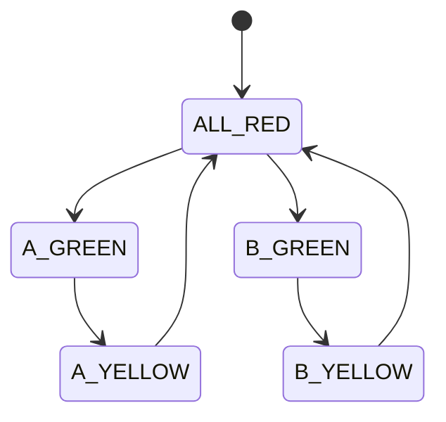

# Máquina de Estados do Semáforo

Estados firmware observados:

- `A_GREEN`
- `A_YELLOW`
- `ALL_RED`
- `B_GREEN`
- `B_YELLOW`

Transição segura padrão:

No Python (`traffic.py`), o plano define durações de verde A/B; o firmware executa a transição física.
