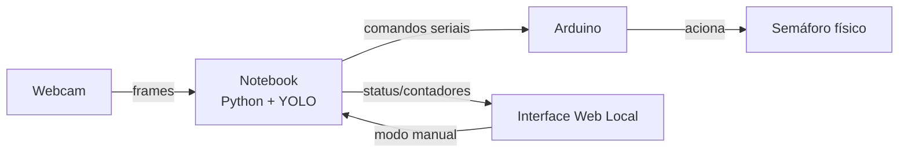

# SmartTraffic — Documentação Técnica

!!! info "Sobre este documento"
    Documentação técnica oficial do **SmartTraffic**, protótipo acadêmico de
    controle semafórico adaptativo com visão computacional e integração com Arduino.

## O que é o SmartTraffic

O **SmartTraffic** é um sistema de controle de tráfego inteligente que utiliza
**visão computacional** (YOLO + OpenCV) para detectar veículos e pedestres em
tempo real, controlando semáforos de forma **autônoma** via integração com
**Arduino**.

O sistema foi desenvolvido para **otimizar a mobilidade urbana**: em vez de
temporização fixa, o estado do semáforo é decidido dinamicamente com base na
presença de agentes no cruzamento, com **limiar de ativação** para evitar
trocas constantes de estado e **alternância por inatividade** após períodos
sem detecções.

## Como funciona (visão de alto nível)

## Comece por aqui

1. [Pré-requisitos](getting-started/prerequisites.md)
2. [Setup do Ambiente](getting-started/setup.md)
3. [Executando o Protótipo](getting-started/running.md)

## Situação atual (resumo)

- duas câmeras no app local;
- controle local com fallback de segurança;
- ingestão resiliente com fila SQLite;
- API e banco operacionais;
- dashboard integrado à API;
- mobile ainda planejado no roadmap.

## Leituras recomendadas

- [Arquitetura do Sistema](overview/architecture.md)
- [Máquina de Estados do Semáforo](control/state-machine.md)
- [Limiar de Ativação (anti-flapping)](control/thresholds.md)
- [Interface Web Local](operations/web-interface.md)
- [FAQ / Troubleshooting](reference/faq.md)