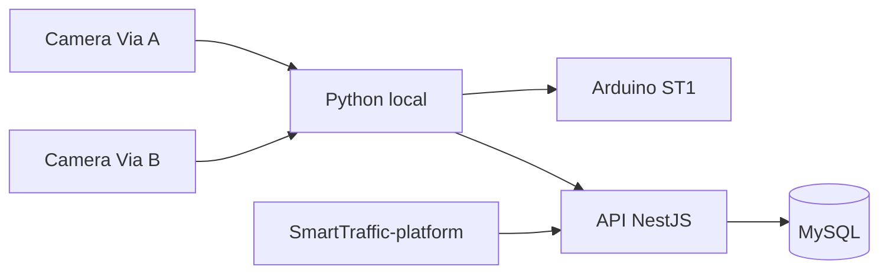

# Arquitetura do Sistema

## Papéis

- Python (`computer-vision`): captura, detecção, planejamento de verde e interface local.
- Arduino (`arduino`): máquina de estados dos semáforos e watchdog de segurança.
- API (`api`): autenticação, contratos HTTP e persistência via Prisma.
- Banco (`database`): schema V2.1, seed e validações SQL.
- Frontend (`SmartTraffic-platform`): visualização operacional por JWT.

## Regra de responsabilidade

- decisão de fase: local;
- persistência/histórico: API + MySQL;
- operação remota: apenas consulta e comandos autorizados na API.
